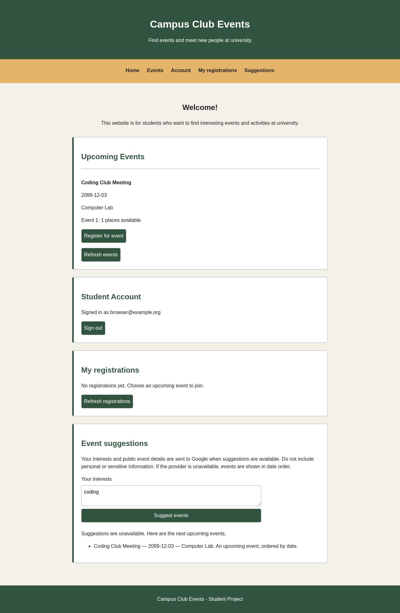

# UI checklist

<!-- Exercise 4 hands this in. Tick an item only when you have checked it, and replace
     the "how I checked" line with what you actually did. An unticked box is not a
     failure: it is a gap you then write into READINESS.md. A ticked box you cannot
     demonstrate at the defence is worse than an unticked one. -->

"Modern" is not a style. It is a short list of things a user notices when they are
missing: the screen tells you what is happening, you can get through it with a keyboard,
the text is readable, and nothing jumps around while it loads.

## Layout and typography

- [ ] **One spacing scale and one type scale.** Sizes come from a small set of design tokens, not from numbers typed where they were needed.
  - how I checked:
- [x] **Responsive at 380, 768 and 1280 pixels wide.** No horizontal scrollbar, no text running under another element.
  - how I checked: Chromium checked 380, 768 and 1280 pixels with no horizontal scrolling.
- [ ] **Nothing jumps while the page loads.** Images and cards reserve their space before their content arrives.
  - how I checked:

## The four states, on every screen

A screen that only handles "it worked" is a screen that lies to the user on the day it matters.

- [x] **Loading.** Something tells the user the app is working, within about 100 ms.
  - how I checked: Delayed the event response and saw Loading events.
- [x] **Empty.** The screen says what this list is for and what to do next, instead of showing nothing.
  - how I checked: Returned an empty list and saw the no-upcoming-events message.
- [x] **Error.** A sentence a person can read. Never a raw JSON body, never a stack trace, never just "Error".
  - how I checked: Interrupted the request and saw the retry message.
- [x] **Success.** The user can see that what they did took effect, without reloading the page to find out.
  - how I checked: Created an account, signed in, registered for an event and cancelled it.

## Keyboard and accessibility

- [ ] **The main flow works with the keyboard alone.** Sign in, do the core action, sign out, without touching the mouse.
  - how I checked:
- [x] **The focused element is visible.** A `:focus-visible` outline that is not switched off.
  - how I checked: Tabbed to Sign out and checked its outline in Chromium.
- [ ] **Text contrast is at least 4.5:1.** Name the tool you measured with.
  - how I checked:
- [ ] **Every input has a label** a screen reader reads, not just placeholder text.
  - how I checked:
- [ ] **The page has a correct `<title>` and `lang`.**
  - how I checked:
- [ ] **Touch targets are at least 44 pixels.**
  - how I checked:

## The model feature

- [x] **It shows that it is thinking.** A model call is slow and a free service may have been asleep; a frozen button is the worst possible answer.
  - how I checked: Delayed the model response and saw Finding suggestions.
- [x] **It shows when it failed,** and the rest of the screen still works.
  - how I checked: Simulated an unavailable provider and saw the upcoming-event fallback.
- [ ] **The user can tell the model's suggestion from a fact.** It is labelled as a suggestion, not presented as data the app knows.
  - how I checked:

## Decisions

- [ ] **Dark mode, or a written decision not to have one.**
  - what I decided and why:

## Evidence

<!-- Screenshots of at least the four states of one screen, and of the model feature
     thinking and failing. A link to them is enough; they do not have to be in the repo. -->

[Browser screenshots](screenshots/)

